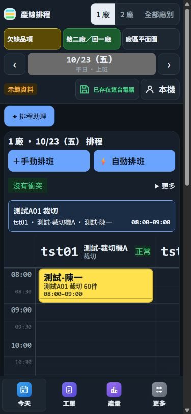
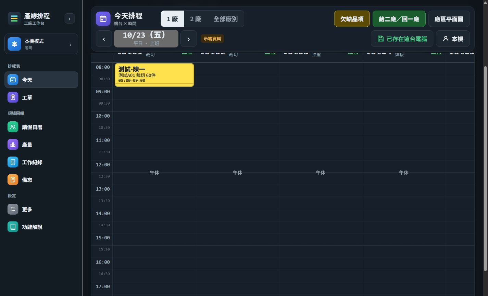
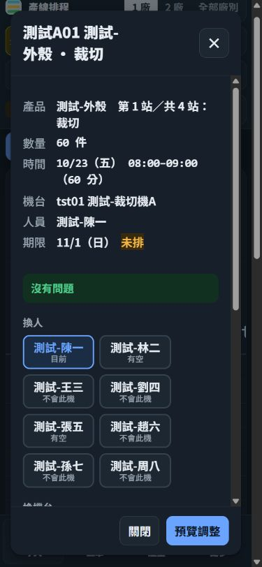

# Factory Scheduler UI/UX 修正驗證

本輪保留並提交前輪三項 P1 修正，再處理稽核 F4 至 F10。驗證使用本機隔離的合成資料，沒有寫入正式 1023 資料，沒有執行 migration 或部署。

## 修正結果

| 稽核項目 | 使用者可見的結果 |
| --- | --- |
| P1 F1 | 手機首屏顯示當日第一筆實際工作，可直接開啟明細。工具列收合後仍保留主要操作。 |
| P1 F2 | 排程助理入口放入頁面正常排列，不再浮在工作方塊上。重新繪製仍保留聊天室與輸入焦點。 |
| P1 F3 | 日班表、週班表與工作檢視直接提供手動及自動排班入口，保留唯讀、預覽與資料待核對限制。 |
| P2 F4 | 「全部廠別」只切換班表範圍。加工通知繼續由「給二廠／回一廠」等既有入口開啟。 |
| P2 F5 | 手機底部保留今天、工單、產量、更多四項。請假日曆、工作紀錄、備忘與功能解說可由更多進入。桌面保留八項，且只標示目前入口。 |
| P2 F6 | 工作明細的內容可捲動，關閉與預覽固定於視窗底部。其他段、刪除與交給系統重排收進展開區塊。 |
| P2 F7 | 空白班表在內容起始處顯示日期、廠別與原因，提供有效日期、其他廠別、資料核對或工作入口。 |
| P2 F8 | 自動方案完全沒有變更時，只顯示「目前班表無需調整」及返回。混合方案保留比較，但無變更選項不提供套用。真正的變更摘要列出段數及影響天數。 |
| P3 F9 | 抽屜改為實心底色，跨廠按鈕使用符合主題的文字色。 |
| P3 F10 | 兩套導覽都改為「每台機台一欄，時間由上往下」，並引導點工作查看內容。 |

無變更判斷比較完整狀態，保留陣列順序並忽略物件鍵的插入順序。件數、固定狀態、ID 或其他資料不同，仍視為變更。這項保護同時涵蓋本機與雲端套用入口；手動排班、事故、工單與保存情境沿用原本流程。

## 驗證

- 在來源提交 `295b9a1` 執行 `cd web; npm test`，986 項全部通過。`npm run build` 通過，仍有既有的大型 chunk 提示。
- 獨立審查涵蓋完整功能差異並執行 96 項相關測試。發現的桌面雙重選取狀態已修正，補上實際產生的導覽順序與選取狀態測試。
- 實際瀏覽器驗證桌面 1440×1000、手機 390×844 與 360×780。確認首筆工作、手動與自動入口、助理不重疊、廠別切換、更多內的各入口、空白日期與無資源廠別恢復、明細預覽與取消、無變更及混合方案返回。
- 工作明細另驗證 130% 應用程式字體及 360×420 縮短視窗。預覽按鈕仍在可視範圍內，內容獨立捲動。待核對與唯讀合成情境未顯示可修改排班的入口。

以實際計算後的文字及底色量測，跨廠按鈕深色主題對比由 1.74 提升至 6.81，淺色為 7.79。班表時間與圖例文字深色為 6.54、淺色為 5.04。這些數字只涵蓋已量測的組合，沒有宣稱整站無障礙合規。

這輪使用桌面瀏覽器調整視窗尺寸，沒有驗證實體手機鍵盤、原生 Safari 或登入後的雲端同步。130% 字體下明細操作可用，但主畫面需要較多捲動。縮短視窗驗證不能取代實體鍵盤驗收。

## 發布限制

主分支的 `.github/workflows/deploy-render.yml` 會在程式變更且同一提交的 Tests 通過後觸發正式部署。這輪依使用者限制停在 PR，不合併、不停用部署設定，也不啟用自動合併。

## 畫面證據

以下皆為合成資料。

